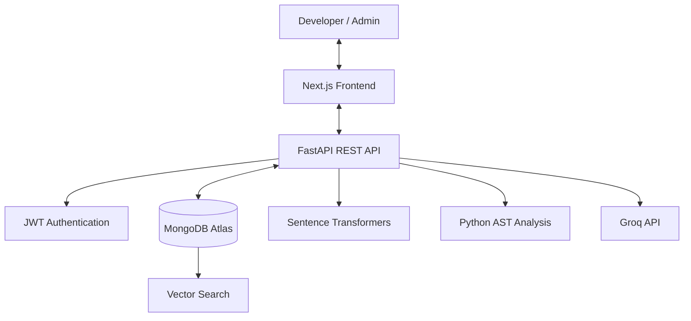

# AI-Powered Codebase Assistant

An AI-powered developer platform that helps developers understand, analyze, and explore software repositories using Abstract Syntax Tree (AST) analysis, semantic vector search, Retrieval-Augmented Generation (RAG), and Large Language Models (LLMs).

The platform combines a Next.js frontend, FastAPI backend, MongoDB Atlas, sentence-transformer embeddings, and Groq-hosted LLMs to provide code insights, architecture exploration, issue detection, and AI-assisted code improvement suggestions.

## ✨ Key Features

### 🔐 Authentication and User Management
- User registration and login.
- JWT-based authentication.
- Protected API endpoints.
- User-specific repository access.
- Role-based access control for users and administrators.

### 📂 Repository Management
- Upload project ZIP files.
- Upload individual source files and folders.
- Browse repository files and directory structures.
- View source code with line numbering.
- Manage uploaded codebases.

### 🧠 AI-Powered Code Intelligence
- Natural-language questions about a codebase.
- Semantic search using vector embeddings.
- Context-aware answers using Retrieval-Augmented Generation (RAG).
- AI-generated code improvement suggestions.
- Line-level code fix recommendations.

### 🔍 Code Analysis
- Python AST-based code inspection.
- Function and class analysis.
- Import and dependency inspection.
- FastAPI route discovery where applicable.
- Detection of selected code quality issues and suspicious patterns.

### 📊 Dashboard and Administration
- Repository and analysis statistics.
- Dashboard for managing codebases.
- Administrative user management.
- Account activation and deactivation controls.
- Audit logging for supported security and administrative events.

### 🎨 User Interface
- Responsive Next.js application.
- Light, dark, and system theme options.
- Sidebar navigation and repository workspace.
- Notifications and confirmation dialogs.

## 🏗️ System Architecture



## 🛠️ Technology Stack

| Component | Technologies |
|---|---|
| Frontend | Next.js 16, React 19, Tailwind CSS |
| Backend | Python 3.12, FastAPI, Uvicorn |
| Database | MongoDB Atlas, PyMongo |
| Authentication | JWT, HTTP Bearer authentication |
| Embeddings | Sentence Transformers |
| Embedding Model | `sentence-transformers/all-MiniLM-L6-v2` |
| Vector Search | MongoDB Atlas Vector Search with cosine similarity |
| LLM Integration | Groq API, LangChain |
| Code Analysis | Python `ast` module |
| Frontend Deployment | Vercel |
| Backend Deployment | Render |
| Version Control | Git and GitHub |

## 🔄 How It Works

1. **Authentication:** A user signs in to access protected features.
2. **Upload:** The user uploads a project archive, files, or folders.
3. **Parsing:** Supported source files are processed for code structure and analysis.
4. **Chunking and Embeddings:** Code is divided into searchable chunks and represented as vector embeddings.
5. **Storage:** Repository data and supported analysis results are stored in MongoDB Atlas.
6. **Retrieval:** Relevant code chunks are retrieved using semantic search.
7. **AI Response:** The backend sends relevant context to the configured LLM to generate a response.
8. **Results:** The frontend displays code insights, analysis results, and recommendations.

## ⚙️ Getting Started

### Prerequisites

Install the following before running the project locally:

- Python 3.12 or later
- Node.js and npm
- MongoDB Atlas account and cluster
- Groq API key
- Git

### 1. Clone the Repository

```bash
git clone https://github.com/AKASH-pro12/AI-Codebase-Assistant.git
cd AI-Codebase-Assistant
```

### 2. Set Up the Backend

Open a terminal in the project directory:

```bash
cd backend
python -m venv venv
```

Activate the virtual environment on Windows PowerShell:

```powershell
.\venv\Scripts\Activate.ps1
```

Install the dependencies:

```bash
pip install -r requirements.txt
```

### 3. Configure Backend Environment Variables

Create a `.env` file inside the `backend/` directory:

```ini
PORT=8000
MONGO_URI=mongodb+srv://<username>:<password>@<cluster>.mongodb.net/?retryWrites=true&w=majority
DATABASE_NAME=codebase_assistant
JWT_SECRET_KEY=<your-strong-random-secret>
GROQ_API_KEY=<your-groq-api-key>
GROQ_MODEL=<your-configured-groq-model>
```

Replace the placeholders with your own configuration values. Use the exact LLM model identifier supported by your Groq account and project configuration.

**Security:** Never commit `.env` files, database credentials, API keys, or JWT secrets to GitHub.

### 4. Run the Backend

From the `backend/` directory:

```bash
python -m uvicorn app.main:app --reload --port 8000
```

Backend API: http://127.0.0.1:8000

Interactive API documentation: http://127.0.0.1:8000/docs

### 5. Set Up the Frontend

Open another terminal from the repository root:

```bash
cd frontend
npm install
```

Create a `.env.local` file inside `frontend/`:

```ini
NEXT_PUBLIC_API_URL=http://127.0.0.1:8000
```

Start the development server:

```bash
npm run dev
```

Frontend application: http://localhost:3000

### 6. Build the Frontend

To check the production build:

```bash
npm run build
```

## 🧪 Testing

The repository includes test scripts for different areas of the application. Run the relevant scripts from the `backend/` directory after configuring the required environment.

| Test Script | Purpose |
|---|---|
| `test_suite.py` | Authentication, authorization, upload validation, and user isolation |
| `test_phase3.py` | AST analysis, vector search, issue detection, and AI-assisted fixes |
| `test_e2e_full.py` | End-to-end application scenarios |
| `test_saas_features.py` | SaaS functionality, account management, and administrative features |

Example:

```powershell
.\venv\Scripts\python.exe test_suite.py
```

Run each test script separately. Results depend on the test configuration, environment variables, and database setup.

## 🔒 Security Considerations

- Keep credentials and API keys in environment variables.
- Use strong, randomly generated JWT secrets.
- Configure CORS to allow only trusted frontend origins.
- Validate uploaded files and prevent unsafe archive extraction.
- Enforce authentication and authorization on protected endpoints.
- Avoid exposing sensitive source code or credentials in logs.
- Rotate any secret that has been accidentally exposed.

## 🌐 Deployment

The project uses separate hosting services for its frontend and backend.

- **Frontend:** Deployed on Vercel.
- **Backend:** Deployed on Render.
- **Database:** MongoDB Atlas.

Configure `NEXT_PUBLIC_API_URL` in the frontend deployment environment to point to the deployed backend API base URL. Configure backend database credentials, JWT secrets, LLM credentials, and CORS origins in the backend environment.

Redeploy the frontend after changing build-time environment variables.

## 📁 Repository Structure

```text
AI-Codebase-Assistant/
├── backend/
│   ├── app/
│   ├── requirements.txt
│   └── test_*.py
├── frontend/
│   ├── app/
│   ├── public/
│   └── package.json
├── render.yaml
└── README.md
```

The exact file and folder structure may vary with the current repository version.

## 🎯 Project Goals

- Make large codebases easier to understand.
- Improve code discovery through semantic search.
- Combine static analysis with context-aware AI assistance.
- Help developers identify potential code quality issues.
- Provide a centralized workspace for repository analysis.
