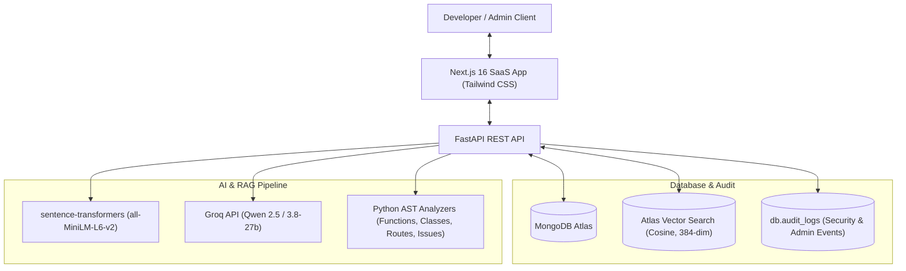

# AI-Powered Codebase Assistant — Professional SaaS Platform

An enterprise-grade developer platform combining AST code parsing, sentence-transformer embeddings, MongoDB Atlas Vector Search, Retrieval-Augmented Generation (RAG), and Groq-hosted LLMs to understand software repositories, detect quality & security issues, generate line-targeted code fixes, and answer complex architectural queries.

---

## Architecture Overview



---

## Technology Stack

- **Backend:** Python 3.12, FastAPI, Uvicorn, PyMongo
- **Database:** MongoDB Atlas (collections: `users`, `codebases`, `code_chunks`, `audit_logs`)
- **Vector Search:** MongoDB Atlas Search Index (`vector_index`, 384 dimensions, cosine similarity) with resilient in-memory cosine fallback
- **Authentication & RBAC:** JWT (HS256), OAuth2 Password flow & HTTP Bearer tokens, Passlib bcrypt, Role-Based Access Control (`user` vs `admin`)
- **Embeddings:** `sentence-transformers/all-MiniLM-L6-v2` (384 dimensions)
- **AI/LLM Engine:** LangChain with Groq API (`qwen/qwen3.8-27b`)
- **Code Parsing & AST:** Python built-in `ast` module (classes, functions, decorators, imports, anti-patterns)
- **Frontend:** Next.js 16 (App Router), React 19, Tailwind CSS v4, Lucide/Heroicons SVG

---

## SaaS Capabilities & Feature Suite

### 1. Role-Based Access Control & Admin Center
- **Normal Users:** Access only their own repositories, source files, chunks, analysis results, and profile. Cannot access another user's resources or administrative endpoints.
- **Administrators:** Dedicated protected management center (`/admin`):
  - Live system metrics (total users, active vs deactivated accounts, total repositories, total chunks, total audit records).
  - User management table with one-click account activation / deactivation (with self-protection).
  - Role management (promote to admin / demote to user).
  - Global codebase management across all users.
  - Immutable security audit trail recording logins, role changes, deactivations, and deletions.
- **Admin Bootstrap CLI:** Controlled command-line script to promote or create initial administrators without exposing public admin registration:
  ```bash
  python -m app.scripts.create_admin yourname@gmail.com
  # Or create a new admin directly:
  python -m app.scripts.create_admin --email admin@gmail.com --password StrongPassword123! --name "System Admin"
  ```

### 2. Account Security & Verification
- **User Authentication:** Sign up with password confirmation validation, login with active-status check (deactivated accounts return HTTP 403).
- **Profile Management:** Edit display name via `PUT /auth/profile`.
- **Password Lifecycle:** Change password with current password verification via `POST /auth/change-password`.
- **Secure Password Reset:** Single-use, 15-minute expiring cryptographic tokens (`POST /auth/forgot-password`, `POST /auth/reset-password`).
- **Email Verification:** Configurable SMTP delivery with OTP confirmation (`POST /auth/send-verification`, `POST /auth/verify-email`).

### 3. Multi-Format Upload & Instant Analysis
- **ZIP Project Upload:** Drag-and-drop or file picker with traversal protection and automated extraction.
- **Multiple Source Files & Folders:** Select or drop individual code files or entire directories (`webkitdirectory`) preserving directory hierarchy.
- **Instant Single-File Inspector:** Run AST inspection and code quality analysis on single files (`POST /codebase/analyze-single-file`) without saving to database.
- **Supported Formats:** `.py`, `.js`, `.jsx`, `.ts`, `.tsx`, `.java`, `.cpp`, `.c`, `.h`, `.html`, `.css`, `.json`, `.md`, `.sql`.
- **Automatic Exclusion:** Secrets (`.env`, `.pem`, `.key`), build artifacts (`node_modules`, `.git`, `venv`), and lockfiles are safely excluded.

### 4. Real Backend Dashboard & Metrics
- Personalized greeting using authenticated user's name.
- Real statistics aggregated from database via `GET /codebase/stats`:
  - Total codebases count
  - Total analyzed source files
  - Total embedded chunks
  - Detected technology stack across repositories
- Repository grid with quick search filter and confirmation modal deletion.

### 5. Codebase Workspace & AI Intelligence
- **File Explorer & Syntax Inspector:** Browse project structure, view raw source code with line numbering.
- **Semantic Vector Search:** Ask natural-language questions and get context-backed answers with citations from the repository.
- **AST Architecture Overview:** Visual map of dependencies, functions, classes, and FastAPI routes.
- **Issue Detection:** Static AST scanner identifying syntax errors, broad exceptions, empty exception handlers, unused imports, and hardcoded values.
- **AI Code Fix Generator:** Generates line-level before/after replacement code suggestions.
- **Improvement Recommendations:** Tailored architectural and refactoring suggestions based on repository scan results.

### 6. Design System & Global Themes
- **Theme Modes:** System, Light, and Dark modes persistent in `localStorage` without hydration flash.
- **AppShell Layout:** Collapsible sidebar with navigation, unified sticky header with breadcrumbs, theme selector, and user profile avatar menu.
- **Feedback & Modals:** Accessible non-blocking toast notifications and confirmation dialogs for destructive actions.

---

## Getting Started

### Prerequisites
- Python 3.12+
- Node.js 18+ and npm
- MongoDB Atlas cluster
- Groq API Key

### Backend Setup

1. Open a terminal in the `backend/` directory:
   ```bash
   cd backend
   ```

2. Create and activate a Python virtual environment:
   ```bash
   # Windows PowerShell:
   python -m venv venv
   .\venv\Scripts\Activate.ps1
   ```

3. Install dependencies:
   ```bash
   pip install -r requirements.txt
   ```

4. Configure environment variables in `backend/.env`:
   ```ini
   PORT=8000
   MONGO_URI="mongodb+srv://<username>:<password>@<cluster>.mongodb.net/?retryWrites=true&w=majority"
   DATABASE_NAME="codebase_assistant"
   JWT_SECRET_KEY="your-strong-random-jwt-secret-key"
   GROQ_API_KEY="your-groq-api-key"
   GROQ_MODEL="qwen/qwen3.8-27b"
   ```

5. (Optional) Bootstrap an administrator account:
   ```bash
   python -m app.scripts.create_admin user@example.com
   ```

6. Start the FastAPI development server:
   ```bash
   python -m uvicorn app.main:app --reload --port 8000
   ```
   Interactive Swagger API documentation: `http://127.0.0.1:8000/docs`

---

### Frontend Setup

1. Open a terminal in the `frontend/` directory:
   ```bash
   cd frontend
   ```

2. Install dependencies:
   ```bash
   npm install
   ```

3. Configure environment in `frontend/.env.local`:
   ```ini
   NEXT_PUBLIC_API_URL=http://127.0.0.1:8000
   ```

4. Start the Next.js development server:
   ```bash
   npm run dev
   ```
   Access the SaaS web application: `http://localhost:3000`

5. Build for production:
   ```bash
   npm run build
   ```

---

## Verification & Test Suites

The platform includes 4 automated verification suites covering 100% of core and SaaS functionality:

1. **SaaS Features & RBAC Suite** (`backend/test_saas_features.py`):
   - Tests profile updates, password change, forgot & reset password flow.
   - Tests email verification and OTP generation.
   - Verifies HTTP 403 enforcement for non-admin on `/admin` endpoints.
   - Tests admin user deactivation and reactivation lifecycle.
   - Verifies multi-file project upload and single-file instant AST analysis.
   - Verifies system audit log persistence.
   ```bash
   cd backend
   .\venv\Scripts\python.exe test_saas_features.py
   ```

2. **Core Auth & Ingestion Suite** (`backend/test_suite.py`):
   - Tests registration, login, Bearer token authorization, ZIP upload validation, and cross-user isolation.
   ```bash
   cd backend
   .\venv\Scripts\python.exe test_suite.py
   ```

3. **AI Pipeline & RAG Suite** (`backend/test_phase3.py`):
   - Tests AST function, class, route, and dependency analyzers.
   - Tests vector search, issue detection, and AI code fix generation.
   ```bash
   cd backend
   .\venv\Scripts\python.exe test_phase3.py
   ```

4. **Full End-to-End Simulation** (`backend/test_e2e_full.py`):
   - Complete multi-user simulation verifying data isolation and AI responses.
   ```bash
   cd backend
   .\venv\Scripts\python.exe test_e2e_full.py
   ```